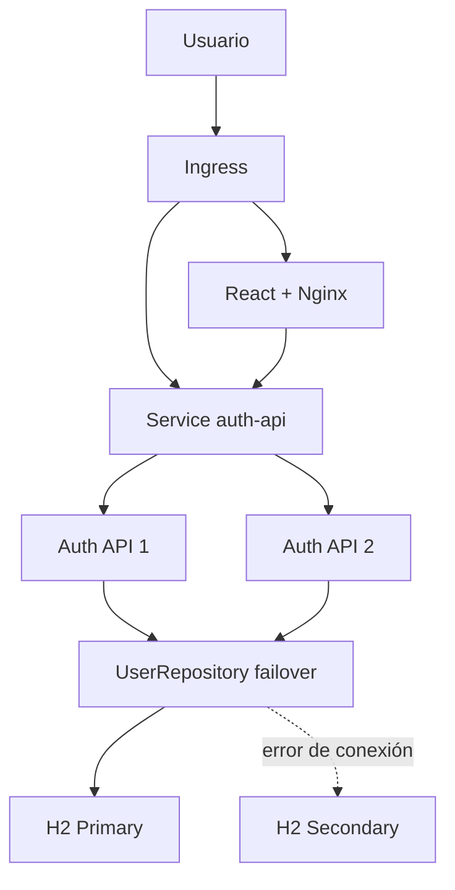

# Arquitectura del laboratorio de autenticación

## Tácticas de disponibilidad

- El Service Kubernetes distribuye tráfico entre exactamente dos pods Spring Boot Ready.
- `liveness` comprueba que el proceso API continúa vivo. `readiness` usa Actuator y una consulta `SELECT 1` a H2 Primary o, si ésta falla, H2 Secondary.
- El repositorio hace hasta tres intentos breves sólo por fallos de conectividad. Un usuario inexistente y una contraseña inválida son respuestas válidas de base de datos y nunca activan failover.
- Primary y Secondary son procesos H2 separados con la misma semilla de sólo lectura. Cada reinicio rehace su base desde la semilla; no existe sincronización de escrituras porque no existen escrituras funcionales.
- El frontend permanece en una única réplica por decisión explícita del laboratorio. Los pods H2 tienen una réplica cada uno y son reemplazados por sus Deployments si fallan.

## Tácticas de desplegabilidad

- Cada tier tiene una imagen Docker reproducible. Helm concentra imágenes, réplicas, recursos, probes, ingress y configuración.
- `helm upgrade --install --atomic --wait` aborta y revierte automáticamente una revisión que no quede lista.
- GitHub Actions prueba código, construye imágenes, crea Kind de un nodo, instala el chart y ejecuta smoke tests. En `main` y tags publica imágenes versionadas en GHCR.

## Limitaciones

Un Kind de un solo nodo demuestra recuperación ante caída de pods, no tolerancia a fallo del nodo ni disponibilidad certificada de 99.99%. H2 y la semilla inmutable son deliberadamente apropiados sólo para este laboratorio; una producción requeriría una base de datos con replicación y almacenamiento duradero.
